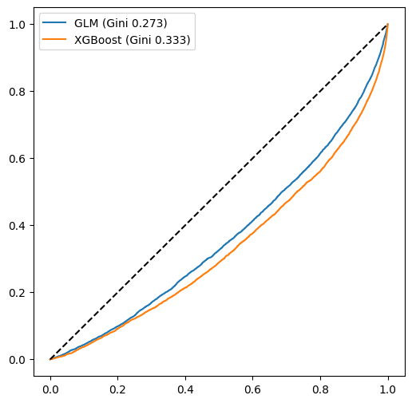
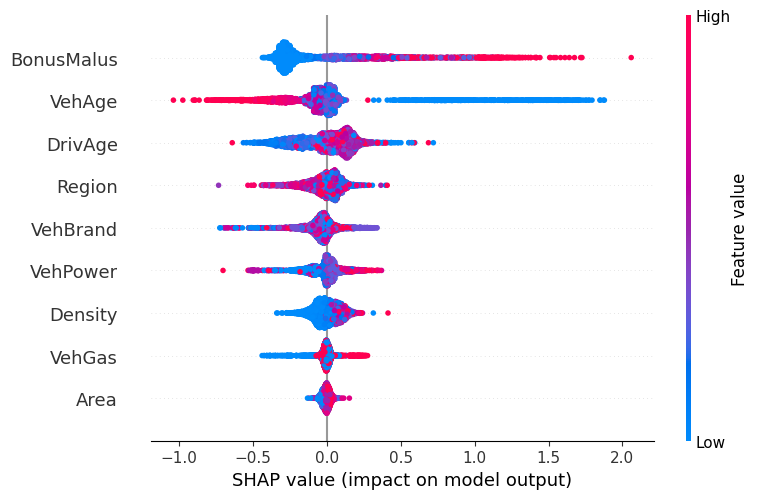

# Motor Insurance Claim-Frequency Pricing — GLM vs XGBoost

**How often will a driver claim, and can machine learning price that better than the industry-standard GLM?**

On 678,013 French motor policies (freMTPL2), a Poisson XGBoost model raised **Gini from 0.273 to 0.333** over a Poisson GLM. The 10% of customers it ranked riskiest made **30.3% of all claims**, against 25.3% for the GLM. A robustness check then found that **most of that gain comes from one segment**: brand B12's brand-new vehicles, which claim at **5.5× the rate** of the same brand's older cars. The project reports both results and what an insurer should do about it.

Built on **Databricks**, with **scikit-learn, XGBoost, SHAP and MLflow**.

---

## Results (20% held-out test set)

| Model | D² (deviance explained) | Gini | Claims made by riskiest 10% | Predicted / actual claims |
|---|---|---|---|---|
| Poisson GLM (baseline) | 4.53% | 0.273 | 25.3% | 1.001 |
| GLM + B12 × new-car interaction | 5.03% | 0.278 | — | — |
| XGBoost (Poisson) **without** vehicle age | 4.84% | 0.291 | — | — |
| **XGBoost (Poisson)** | **7.86%** | **0.333** | **30.3%** | 0.998 |

- **D²** = share of Poisson deviance explained over an average-only model. Low values are normal for claim frequency, because most claim occurrence is random.
- **Gini** (exposure-weighted Lorenz curve) = how well the model ranks risk, the metric pricing teams care about most.
- Both main models stay **balanced**: total predicted claims are within 0.2% of actual.

---

## Key findings

1. **BonusMalus (no-claims score) is the strongest rating factor.** One-way frequency rises from 0.080 at the best score (50) to 0.371 at 100–150, about 4.6×. SHAP gives it the largest average effect (×1.35).
2. **Driver age is U-shaped, with a bump in middle age.** Risk is ×1.2–2.0 at 18–22, lowest at 25–38 (×0.6–0.9), then rises again around **45–55** (about ×1.2). A common explanation is teenage children driving a parent's insured car. Simple age bands in a GLM smooth over this.
3. **Urban areas claim more.** Frequency rises 70% from the most rural area (A) to the most urban (F). Once population density is in the model, the coarser `Area` factor adds almost nothing (×1.02), so it's redundant.
4. **Brand B12's new vehicles are a distinct high-risk segment.** They make up 64% of all new cars and claim 0.452 times a year, against 0.082 for B12's older cars and 0.124 for other brands' new cars. Their policies average only about 0.26 years, consistent with a fleet, rental or leasing book, or a recording quirk.

---

## Robustness check: is XGBoost's gain real?

SHAP showed XGBoost relying heavily on brand-new vehicles, an effect the one-way analysis had already flagged as suspicious. So I tested it:

- **Removing vehicle age** wiped out about **90% of XGBoost's D² gain** (7.86% → 4.84%) and about 70% of its Gini gain (0.333 → 0.291).
- The GLM already captured the **average** new-car effect: adding a new-car flag changed nothing. So the gain is an **interaction**, not a main effect.
- A single hand-built **B12 × new-car** term recovered only a small part of the gap (D² 5.03%). The effect is multi-way, and XGBoost picks it up across several factors.

**Recommendation.** XGBoost's genuine edge without that segment is modest (Gini 0.291 vs 0.273). Before using the larger uplift in pricing, confirm with the data owner what the B12 new-car segment is. If it's a real fleet or rental book, price it as a separate segment. If it's a recording artefact, plan on the smaller uplift.

---

## Method

| Step | What and why |
|---|---|
| **Data** | freMTPL2freq from OpenML: 678,013 policies, 12 columns, saved as Delta tables in Unity Catalog (`workspace.pricing`) |
| **Cleaning** | Capped claim counts at 4 (9 policies had up to 16 claims in under a year) and exposure at 1 year (1,224 policies above 1), following Noll, Salzmann & Wüthrich (2018) |
| **Target** | Claim frequency = claims ÷ exposure, with **exposure as the sample weight**, so a 3-month policy counts less than a 12-month one |
| **Exploration** | One-way frequency by factor, read alongside exposure share so thin groups aren't over-read |
| **GLM baseline** | scikit-learn `PoissonRegressor` with log link; age bands, one-hot categories, BonusMalus capped at 150, log density |
| **XGBoost** | `objective="count:poisson"`, native categorical handling, early stopping on a 10% validation split (745 trees) |
| **Evaluation** | Poisson deviance and D², exposure-weighted Lorenz curve and Gini, top-decile claim share, predicted-to-actual balance |
| **Explainability** | SHAP values via XGBoost's `pred_contribs`, read as multipliers (exp of the log-scale contribution) |
| **Tracking** | Every model logged to **MLflow**: parameters, metrics, the Lorenz chart, and the trained XGBoost model |

---

## Run it

1. Import `motor_claims_frequency_pricing.ipynb` into a Databricks workspace (Free Edition works) and attach serverless compute.
2. Run top to bottom. The first cell downloads freMTPL2 from OpenML; `%pip install xgboost shap` restarts Python, and the next cell rebuilds the data and models.
3. Results appear in the notebook and in the MLflow experiment `motor-claims-frequency`.

## Limitations and next steps

- **Frequency only.** A full pure-premium model also needs claim **severity** (cost per claim, e.g. a Gamma GLM), using freMTPL2sev.
- **The B12 segment is unexplained.** It needs the data owner to confirm whether it's a fleet or rental book.
- **Register and serve the model** through the Unity Catalog model registry, and add a calibration-by-decile check before any pricing use.
- **Tune hyperparameters** with cross-validation. The current XGBoost settings are sensible defaults plus early stopping.

## Data and reference

- Dataset: freMTPL2freq, [OpenML 41214](https://www.openml.org/d/41214) (from the R package CASdatasets).
- Noll, A., Salzmann, R. and Wüthrich, M. V. (2018). *Case Study: French Motor Third-Party Liability Claims.* SSRN.
